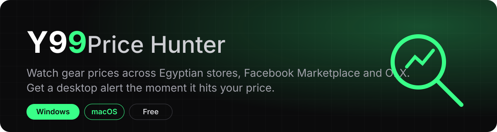
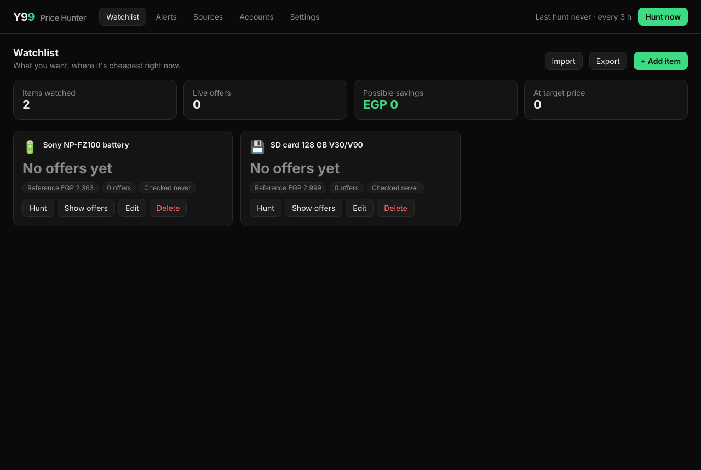

<p align="center">
  
</p>

<p align="center">
  <a href="https://github.com/y99-tech/y99-price-hunter/releases/latest/download/Y99-Price-Hunter-Windows-Setup.exe"></a>
  <a href="https://github.com/y99-tech/y99-price-hunter/releases/latest/download/Y99-Price-Hunter-Mac.dmg"></a>
  <a href="../../releases/latest"></a>
</p>

<p align="center">
  <b>Made by <a href="https://y99.tech">Y99</a></b> · <a href="https://youssry99.com/links">All links</a> · <a href="https://instagram.com/y99.agency">Instagram</a>
</p>

# Y99 Price Hunter

A free desktop app for **Windows and Mac** that watches the price of the gear you want — across
**17 Egyptian camera stores**, **Facebook Marketplace** and **OLX / dubizzle** — and pings you the moment
it drops to your price.

It's the desktop edition of the Price Hunter inside [Y99 OS](https://y99.tech/os), made so anyone can run it
on their own computer with their own accounts.

<p align="center"></p>

---

## Contents

1. [Download & install](#1-download--install)
2. [Add your first item](#2-add-your-first-item)
3. [Run a hunt & read the results](#3-run-a-hunt--read-the-results)
4. [Connect Facebook Marketplace & OLX](#4-connect-facebook-marketplace--olx-optional)
5. [Add your own stores](#5-add-your-own-stores)
6. [Settings, alerts & tips](#6-settings-alerts--tips)
7. [FAQ & troubleshooting](#7-faq--troubleshooting)
8. [بالعربي — طريقة الاستخدام](#بالعربي--طريقة-الاستخدام)

---

## 1. Download & install

Click the file for your computer (always the newest version):

| Your computer | Download | What to do |
| --- | --- | --- |
| **Windows** (recommended) | [`Y99-Price-Hunter-Windows-Setup.exe`](https://github.com/y99-tech/y99-price-hunter/releases/latest/download/Y99-Price-Hunter-Windows-Setup.exe) | Double-click. It installs in a few seconds, opens, and puts a shortcut on your Desktop. |
| **Windows, no install** | [`Y99-Price-Hunter-Windows-Portable.exe`](https://github.com/y99-tech/y99-price-hunter/releases/latest/download/Y99-Price-Hunter-Windows-Portable.exe) | Double-click to run. Nothing is installed; works from a USB stick too. |
| **Windows, antivirus blocks the .exe** | [`Y99-Price-Hunter-Windows-NoInstall.zip`](https://github.com/y99-tech/y99-price-hunter/releases/latest/download/Y99-Price-Hunter-Windows-NoInstall.zip) | Right-click → *Extract All*, open the folder, double-click **Y99 Price Hunter.exe**. |
| **Mac** (Apple chip M1–M4 or Intel) | [`Y99-Price-Hunter-Mac.dmg`](https://github.com/y99-tech/y99-price-hunter/releases/latest/download/Y99-Price-Hunter-Mac.dmg) | Open it, drag **Y99 Price Hunter** into **Applications**, then double-click **Open-Me-First-Mac** (once). |

All versions and release notes: **[Releases](../../releases)**.

**First launch only:**

- **Windows** may show *"Windows protected your PC"*. Click **More info → Run anyway**. The app isn't
  code-signed yet; the whole source code is in this repo and every download is built by GitHub Actions.
- **Mac:** if *Open-Me-First-Mac* is blocked, right-click it → **Open** → **Open**. Or go to
  **System Settings → Privacy & Security** and click **Open Anyway** next to Y99 Price Hunter. After that it
  opens normally from Launchpad.

## 2. Add your first item

The app opens on **Watchlist**. Click **+ Add item** and fill in:

| Field | What to put | Example |
| --- | --- | --- |
| **Name** | What you call it | `Sony NP-FZ100 battery` |
| **Icon** | Any emoji, just for looks | 🔋 |
| **Search for** | One search per line — the app runs each one on every store | `NP-FZ100`<br>`FZ100` |
| **Title must contain** | Words every result *must* have (comma separated) | `fz100` |
| **Skip titles with** | Words that throw a result out | `dummy, charger, adapter` |
| **Reference price (EGP)** | The normal price — used to show how much you save | `2363` |
| **Alert me at or under (EGP)** | Your target. You get a notification at this price or lower | `1900` |
| **Ignore prices under (EGP)** | Skips fake "EGP 1" marketplace listings | `500` |

Click **Save**. Add as many items as you like. **Export** saves your watchlist to a file and **Import**
loads it back (handy for sharing a list with a friend or moving to a new PC).

> **Tip:** short model codes (`FZ100`, `A7IV`, `SEL50F18`) find more listings than long full names.
> Then use *Title must contain* and *Skip titles with* to remove the junk.

## 3. Run a hunt & read the results

- Click **Hunt now** (top right) to search everything immediately, or **Hunt** on a single item.
- After that the app hunts on its own every few hours (3 h by default) while it's open or in the tray.
- Each card shows the **cheapest live offer**, the store, and how much it is under your reference price.
  Click **Show offers** to see every matching listing, its price history, and a link to open it.
- The top row sums it up: **Items watched**, **Live offers**, **Possible savings**, **At target price**.
- **Alerts** lists every price drop and target hit. **Mark all read** clears the badge.

## 4. Connect Facebook Marketplace & OLX (optional)

Stores work with no login. Marketplace and OLX need your own account:

1. Open **Accounts** and click **Sign in** next to Facebook (or OLX).
2. A normal Facebook / OLX window opens *inside the app*. Log in there as you usually do.
3. Close the window. The status turns **Signed in**. Done.
4. In **Settings**, set your **Facebook Marketplace city** (as in the Marketplace link: `cairo`,
   `alexandria`, `giza`…).

The app never sees your password — see [Your cookies, your computer](#your-cookies-your-computer).
To disconnect, click **Sign out & clear cookies**.

## 5. Add your own stores

Open **Sources** → **+ Add store**:

- **WooCommerce** or **Shopify** store: just type the **Site address** (`example-store.com`). That's it.
- Any other site, choose **Web page** and give its **Search URL** with `{q}` where the search goes,
  e.g. `https://example-store.com/search?q={q}`.

Untick **On** to pause any of the 17 built-in stores, or **Remove** it.

## 6. Settings, alerts & tips

- **Every (hours):** how often to hunt automatically (1–48). 3–6 hours is plenty.
- **Look:** light (default) or dark theme.
- **Keep running in the tray / menu bar:** closing the window keeps the app running in the system tray / menu bar so hunts and
  alerts continue. Quit from the tray icon.
- **Notifications:** you get a desktop notification when an item reaches your alert price or a new lowest
  price. Click it to open the listing. Make sure notifications for *Y99 Price Hunter* are allowed in
  Windows / macOS settings.

## 7. FAQ & troubleshooting

<details><summary><b>My antivirus (Norton, Avast…) says it's a threat</b></summary>

The app is new and not code-signed, so some antivirus apps block it on "reputation" (too few downloads so
far). It contains no malware: the source is in this repo and every file is built by GitHub Actions.
Use the **NoInstall.zip** download (flagged far less often), or in Norton open the alert →
**Restore & exclude this file**.
</details>

<details><summary><b>An item says "No offers yet"</b></summary>

Click **Hunt** on it and wait a minute. If it's still empty, loosen *Title must contain*, add a shorter
search line (just the model code), and hover the **Errors** number under **Alerts → Recent hunts** to see what went wrong.
</details>

<details><summary><b>Marketplace shows nothing</b></summary>

Check **Accounts** says *Signed in* and your city is right in **Settings**. Marketplace searches are slow on
purpose (a few seconds apart), so give a full hunt a few minutes.
</details>

<details><summary><b>Where is my data? How do I uninstall?</b></summary>

Everything is one JSON file on your computer: `%APPDATA%\Y99 Price Hunter` (Windows) or
`~/Library/Application Support/Y99 Price Hunter` (Mac). Uninstall from *Settings → Apps* on Windows, or drag
the app to the Bin on Mac. Your watchlist is kept unless you delete that folder.
</details>

<details><summary><b>Found a bug or want a store added?</b></summary>

Open an [issue](../../issues) or message [@y99.agency](https://instagram.com/y99.agency).
</details>

---

## بالعربي — طريقة الاستخدام

<div dir="rtl">

**Y99 Price Hunter** برنامج مجاني للويندوز والماك بيراقب أسعار المعدات اللي عايزها في ١٧ محل كاميرات في مصر،
وفيسبوك ماركت بليس، وأوليكس، ويبعتلك إشعار أول ما السعر ينزل للرقم اللي إنت حاطه.

١. **التحميل:** ويندوز ← [Y99-Price-Hunter-Windows-Setup.exe](https://github.com/y99-tech/y99-price-hunter/releases/latest/download/Y99-Price-Hunter-Windows-Setup.exe) — ماك ← [Y99-Price-Hunter-Mac.dmg](https://github.com/y99-tech/y99-price-hunter/releases/latest/download/Y99-Price-Hunter-Mac.dmg)

٢. **أول مرة بس:** لو ويندوز قال *Windows protected your PC* دوس **More info** وبعدين **Run anyway**.
على الماك افتح **Open-Me-First-Mac** مرة واحدة. لو الأنتي فايرس منع الملف، نزّل نسخة
[NoInstall.zip](https://github.com/y99-tech/y99-price-hunter/releases/latest/download/Y99-Price-Hunter-Windows-NoInstall.zip).

٣. **ضيف منتج:** من **Watchlist** دوس **+ Add item**، اكتب الاسم، وكلمات البحث (سطر لكل كلمة زي `FZ100`)،
والكلمات اللي لازم تكون في العنوان، والكلمات اللي تتشال (زي `dummy, charger`)، والسعر العادي، والسعر اللي
عايز تتنبه عنده. دوس **Save**.

٤. **دوّر:** دوس **Hunt now**. البرنامج هيدور لوحده كل ٣ ساعات، وكل كارت هيوريك أرخص عرض والمحل وقد إيه بتوفر.
**Show offers** بيوريك كل العروض وتاريخ السعر.

٥. **فيسبوك وأوليكس (اختياري):** من **Accounts** دوس **Sign in** وسجّل دخول عادي جوه البرنامج. الباسورد
مش بيوصل للبرنامج، والكوكيز بتفضل على جهازك بس. ومن **Settings** اختار مدينتك للماركت بليس.

٦. **محل جديد:** من **Sources** اكتب عنوان أي محل WooCommerce أو Shopify وخلاص.

أي مشكلة أو اقتراح: كلمنا على [@y99.agency](https://instagram.com/y99.agency) أو افتح [Issue](../../issues).

</div>

---

## How it works

1. **Watchlist** — your items, searches, filters and target prices.
2. **Hunt** — every few hours (or on *Hunt now*) the app searches every source, keeps the listings that
   match, tracks each one's price history, and shows the cheapest live offer and how much you save.
3. **Alerts** — a desktop notification when an item hits your alert price or a new low.

### Sources

| Type | How it searches | Login |
| --- | --- | --- |
| WooCommerce stores | public Store API (`/wp-json/wc/store/v1/products`) | none |
| Shopify stores | public search (`/search/suggest.json`) | none |
| Web page | opens the store's search page and reads product cards | none |
| Facebook Marketplace | opens Marketplace search with **your** session | your Facebook |
| OLX / dubizzle Egypt | opens OLX search with **your** session | optional |

17 Egyptian camera stores come preloaded (Shams, Dot Cam, RayStore, General, CameraX, Fotoexpress,
King Digital, DMT, ESA CAM, …). Add any other store from **Sources**.

### Your cookies, your computer

On **Accounts** you sign in to Facebook / OLX on the real site, inside the app. The app never sees your
password. It keeps the site's cookies in its own private browser profile on your computer (like a
separate Chrome profile) and uses them only to open search pages for you. Nothing is sent to Y99 or
anywhere else. *Sign out & clear cookies* removes them.

Marketplace searches are deliberately slow (a few seconds apart). Automated browsing may still be
against Facebook's or OLX's terms, so keep the hunt interval reasonable and use your own account.

Data (watchlist, offers, history) is a JSON file in the app's data folder:
`%APPDATA%\Y99 Price Hunter` on Windows, `~/Library/Application Support/Y99 Price Hunter` on Mac.

## Develop

```bash
npm install
npm start          # run the app
npm test           # unit tests (price parsing, matching, hunt logic)
npm run dist:win   # build Windows installers (on Windows)
npm run dist:mac   # build Mac .dmg/.zip (on a Mac)
```

Pushing to `main` builds Windows and Mac on GitHub Actions; pushing a tag like `v1.0.0` also attaches the
installers to a GitHub Release.

```
main.js          Electron main: windows, tray, scheduler, sign-in windows, hidden search pages
preload.js       safe bridge to the UI
src/hunter.js    the hunt: search → match → offers, history, best price, alerts
src/sources.js   source adapters + built-in store list + page reader for Marketplace/OLX
src/match.js     price parsing (EGP, Arabic digits) and title matching
ui/              the interface (Y99 black + green)
```


---

<p align="center"><sub>Built by <a href="https://y99.tech">Y99</a> · Cairo · <a href="https://youssry99.com/links">youssry99.com/links</a></sub></p>
